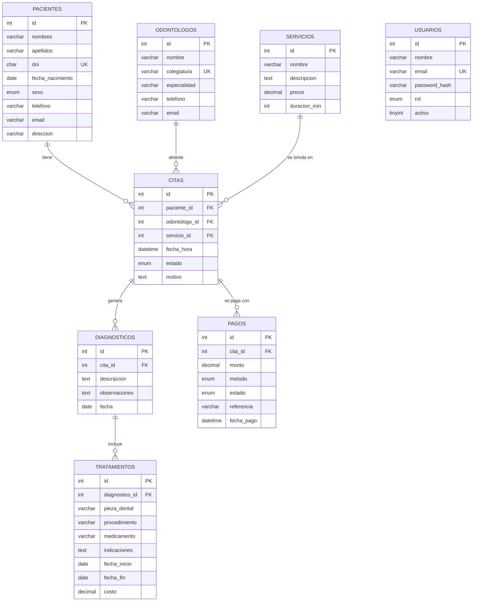

# Sistema de Gestión · Clínica Odontológica "Sonrisa Perfecta"

Sistema web en PHP (MVC) con MySQL/MariaDB para el **Caso 0A**. Está basado en la estructura del proyecto *Sistema de Veterinaria MVC*.

## Requisitos del caso y dónde se resuelven

| Requisito del caso | Implementación | Archivo / módulo |
|---|---|---|
| Registrar pacientes con sus datos personales | Módulo Pacientes: nombres, apellidos, DNI, fecha de nacimiento, sexo, teléfono, correo y dirección | `pacientes.php`, `model/Paciente.php` |
| Administrar odontólogos según su especialidad | Módulo Odontólogos con lista fija de especialidades | `odontologos.php`, `opciones()` en `controller/BaseController.php` |
| Programar citas indicando fecha, hora y estado | Módulo Citas (estado: pendiente, confirmada, atendida, cancelada) | `citas.php`, `model/Cita.php` |
| Registrar diagnósticos y tratamientos | Módulos Diagnósticos y Tratamientos (con pieza dental) | `diagnosticos.php`, `tratamientos.php` |
| Gestionar los servicios que ofrece la clínica | Módulo Servicios con precio y duración | `servicios.php` |
| Controlar pagos: efectivo, tarjeta de crédito, débito o Yape | Módulo Pagos con esos cuatro métodos | `pagos.php`, `model/Pago.php` |
| Generar reportes de atenciones, ingresos y citas pendientes | Módulo Reportes por periodo (solo lectura) | `reportes.php`, `model/Reporte.php` |
| Login con registro de usuarios y cierre de sesión | Registro, ingreso y salida con sesión protegida | `views/login.php`, `views/logout.php` |
| Encabezado de dos niveles | Barra superior (marca y usuario) + barra de navegación | `views/layout.php` |
| Barra de navegación horizontal | Menú principal bajo el encabezado | `views/layout.php` |
| Menú vertical al lado derecho | Columna "Menú rápido" a la derecha | `views/layout.php` |
| Tarjetas informativas con imágenes en la página principal | Tarjetas por módulo con imagen y conteo de registros | `views/home.php`, `imagenes/modulos/` |
| Pie de página al final | Pie fijo al final de cada página | `views/layout.php` |
| Responsive | Diseño adaptable a móviles (menú superior en pantallas pequeñas) | `assets/css/clinica.css` |
| Operaciones CRUD en sus módulos | Crear, consultar, editar y eliminar en los 7 módulos de registros | `controller/BaseController.php` (`CrudController`) |
| Consultas preparadas contra inyección SQL | PDO con parámetros en todas las consultas | `model/*.php` |

## Estructura del proyecto

```
sistema-clinica-odontologica/
├── index.php                    → redirige al login
├── config/database.php          → única configuración (variables de entorno opcionales)
├── controller/                  → BaseController (CRUD común, validación), AuthController y un controlador por módulo
├── model/                       → BaseModel (acceso genérico) y un modelo por tabla + Reporte
├── views/
│   ├── layout.php, login.php, logout.php, home.php, reportes.php
│   ├── componentes/             → formulario y tabla genéricos (se reutilizan en todos los módulos)
│   └── pacientes.php + pacientes/ (index, form, lista), igual para cada módulo
├── assets/css/clinica.css, assets/js/app.js
├── imagenes/                    → logo y tarjetas
└── database/
    ├── clinica_odontologica.sql → esquema y catálogo inicial de servicios
    └── datos_demo.sql           → datos de ejemplo (opcional)
```

## Instalación (XAMPP en Windows/Mac/Linux)

1. Copie la carpeta `sistema-clinica-odontologica` dentro de `htdocs`.
2. Inicie **Apache** y **MySQL** en XAMPP.
3. Importe `database/clinica_odontologica.sql` desde phpMyAdmin o MySQL Workbench.
4. (Opcional) Importe `database/datos_demo.sql` **una sola vez** para tener pacientes, citas y pagos de ejemplo.
5. Si su usuario o contraseña de MySQL no son los de XAMPP, defina las variables `DB_HOST`, `DB_NAME`, `DB_USER` y `DB_PASS`, o edite `config/database.php`.
6. Abra `http://localhost/sistema-clinica-odontologica/`.

**Requisitos:** PHP 8.0 o superior y MySQL 5.7+ / MariaDB 10.4+ (probado con PHP 8.2 y MariaDB 10.11).

## Primer ingreso

No hay usuarios predeterminados. En la pantalla de acceso:

1. Escriba **Nombre**, **Correo** y **Contraseña** (mínimo 10 caracteres).
2. Presione **Registrarme**.
3. Ingrese con el mismo correo y contraseña en **Ingresar**.

## Reglas de negocio implementadas

- **DNI** de 8 dígitos, único. La **colegiatura** de cada odontólogo también es única.
- **Sin cruces de horario:** un odontólogo no puede tener dos citas que se solapen. Se calcula con la duración del servicio. Una cita cancelada no bloquea el horario.
- **Pagos:** el monto debe ser mayor que cero. Si se marca como *pagado* sin fecha, se registra la fecha actual.
- **Tratamientos:** la fecha de fin no puede ser anterior a la de inicio.
- **Integridad:** no se elimina un paciente, odontólogo, servicio, cita, diagnóstico o tratamiento que tenga registros relacionados; el sistema muestra un mensaje claro.
- **Reportes:** por defecto muestran el mes en curso; si las fechas están invertidas, se corrigen solas.

## Seguridad

- Consultas con **PDO y parámetros preparados** (protección contra inyección SQL).
- **Token CSRF** en todos los formularios.
- Salida escapada con `htmlspecialchars` (protección contra XSS).
- Contraseñas guardadas con `password_hash`; la sesión se regenera al ingresar.
- Las credenciales de base de datos **no** están escritas en el código.
- Para producción faltan: HTTPS, permisos por rol, auditoría y copias de seguridad.

## Modelo de datos


